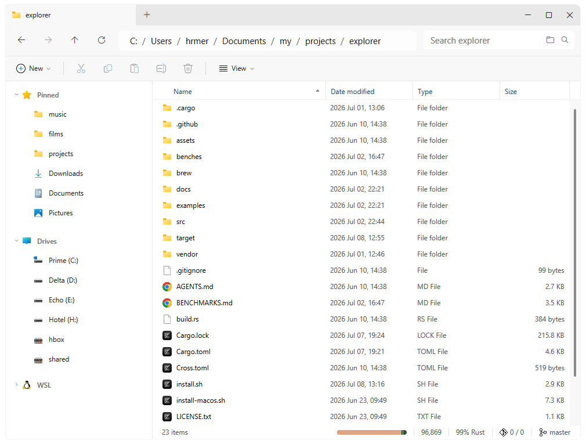

<p align="center">
  
</p>

<h1 align="center">Explorer</h1>

<p align="center">
  <strong><s>Windows</s> File Explorer for macOS, Linux, and Windows. Built in pure Rust with <a href="https://gpui.rs/">GPUI</a>.</strong>
</p>

<p align="center">
  <a href="https://github.com/hmerritt/explorer/releases/latest"></a>
  <a href="https://coveralls.io/github/hmerritt/explorer?branch=master"></a>
  <a href="https://github.com/hmerritt/explorer/releases/latest"></a>
  <a href="./LICENSE.txt"></a>
</p>

<p align="center">
  <a href="https://explorer.mrrtt.me/">🌐 Website and downloads</a>
  |
  <a href="#-install">💾 Install</a>
  |
  <a href="#-features">⚡ Features</a>
  |
  <a href="#-anti-features-that-will-not-be-implemented"><s>🔃 Anti-Features</s></a>
</p>



## 💾 Install

[**➡️ Manually Download The Latest Release Here**](https://github.com/hmerritt/explorer/releases/latest), or install via one of the supported package managers:

#### ➡️ macOS via Homebrew

> First launch may need approval in **System Settings → Privacy & Security**

```sh
brew install --cask hmerritt/tap/explorer
```

#### ➡️ Linux installer

```sh
curl -fsSL https://raw.githubusercontent.com/hmerritt/explorer/master/install.sh | sh
```

#### ➡️ Windows via Scoop

```sh
scoop bucket add hmerritt https://github.com/hmerritt/scoop-bucket
scoop install hmerritt/explorer
```

## ⚡ Features

- Cross-platform macOS, Linux (Wayland/X11), and Windows
- GPU-accelerated Explorer UI ([GPUI](https://gpui.rs/))
- Tabs
- Arrow keys navigation
- Sidebar custom pins (drag-to-pin)
- Key bindings for ~~everything~~ most things
- HTTP, HTTPS, FTP, and SFTP file URLs can be downloaded directly when pasted
- `yt-dlp` integration, supported URLs can be downloaded as videos when pasted
- Native ZIP creation with Finder-style `Compress` naming and progress
- A simple, functional, built-in image viewer (you can set `explorer` as the default image viewer)
- A native, paginated [EPUB reader](docs/epub-reader.md) with reading settings, search, bookmarks, and note previews
- Archive extraction (supported archive formats including `7z`, `bz2`, `gz`, `rar`, `tar`, `xz`, `zip`, `zst`)
- Search
    - Type-to-search current directory
    - Recursive search (no pre-indexing like Windows, but still pretty quick)
- Git repo support
    - Branch
    - Outgoing/Incoming commits
    - Lines of code
    - Primary language used
    - Github-style language makup bar
- `Alt+hover` special keybinding to instantly preview files
    - Images
    - Videos
    - PDF first-page preview
    - EPUB cover preview
    - Text (plain text, logs, markdown, code files, etc...)
- File properties
    - Generic file/folder information
    - Image preview in properties
    - Video frames preview in properties
    - In-depth image/video/audio metadata
    - Audio spectrum analyser (inspired by [Spek](https://www.spek.cc/))
    - Image EXIF tags (grouped and organised for ease-of-use)
- Removable and portable storage
    - Native mounted volumes, USB mass storage, and optical media
    - Android phones, cameras, and media players using MTP/PTP
    - In-app copy/move, rename, folder creation, delete, thumbnails, and file opening when supported by the device

## 🔃 'Anti-Features' that will NOT be implemented

- 3D Objects _that gets used as much as a welcome mat at a house that never has visitors_
- File grouping _that randomly appears when you didn't set it_
- List, Titles, and Content file view modes _that are as pointless as a screen door on a submarine_
- Search _that takes as long as a cross-country flight_
- Context menu delays _that take longer than my wife does when deciding where to eat_
- _Claiming it's built in 'pure rust' when really it's just a WebView wrapper with basic app logic in rust_.

---

https://github.com/user-attachments/assets/cf7ca1d4-1609-4270-88e4-0798fad9b38a

> Downloading a file URL directly into the current directory.

---

## Configuration

Explorer stores settings as JSON and watches the file for changes while the app is running.

- macOS: `~/.config/explorer/settings.json`
- Linux: `${XDG_CONFIG_HOME:-~/.config}/explorer/settings.json`
- Windows: `%USERPROFILE%/.config/explorer/settings.json`

Minimal example:

```json
{
    "app": {
        "copy_verify": true,
        "start": "~/Downloads"
    },
    "updater": {
        "enabled": true,
        "check_interval": "6h",
        "feed_url": "https://github.com/hmerritt/explorer/releases/latest/download"
    },
    "view": {
        "media_preview_size": 400,
        "mode": "details",
        "search_mode": "detailed",
        "show_extensions": true,
        "show_hidden": false,
        "show_folder_sizes": false
    }
}
```

Example with sidebar and contextmenu items:

```json
{
    "app": {
        "start": "~/Downloads",
        "ytdlp_options": ["-S", "ext:mp4"]
    },
    "view": {
        "mode": "details",
        "search_mode": "detailed",
        "show_extensions": true,
        "show_hidden": false,
        "show_folder_sizes": false
    },
    "sidebar": {
        "hide_groups": ["network", "wsl"],
        "hide_items": ["google_drive", "C:/"],
        "pinned": ["~", "~/Downloads", "~/Documents", "~/Pictures"],
        "order": {
            "drives": ["D:/", "C:/"],
            "network": ["sftp://production/var/www", "onedrive", "google_drive"],
            "wsl": ["//wsl.localhost/Ubuntu/"]
        },
        "width": 225
    },
    "contextmenu": [
        {
            "exe": "zed",
            "icon": "",
            "args": [],
            "label": "Open with Zed",
            "only": ["*directory", "*folders", "*files"]
        }
    ]
}
```

Sidebar item order is stored independently for the `drives`, `network`, and `wsl` groups.
Path-backed items use their displayed path, SFTP bookmarks use a credential-free URL including
the bookmarked folder, and cloud roots use `google_drive` or `onedrive`. Pinned folders are ordered
directly by the `pinned` array. Existing `sidebar.items` settings are migrated to `sidebar.pinned`.

Context-menu entries can launch an external executable or invoke a built-in action. The native
no-dialog ZIP action is configured as:

```json
{
    "label": "Compress",
    "action": "compress",
    "only": ["*file", "*folder"]
}
```

Custom executables run in the context item's directory: a selected file's containing
folder, a selected folder itself, or the current directory for a background menu.
Multiple selections launch one process using the focused/right-clicked item's directory.

When `args` is omitted, selected file paths are passed automatically, in selection order;
folder paths are excluded. When `args` is present, only the supplied arguments are used:

- `"args": []` (or `"args": ""`) runs with no arguments, even for files.
- `"args": ["--inspect"]` passes only `--inspect`.
- `"args": ["{path}"]` passes the first selected path, including a folder.
- `"args": ["--inspect", "{paths}"]` passes the flag followed by every selected path.

On background menus, `{path}` and `{paths}` refer to the current directory.
Placeholders expand only when they occupy a whole argument; embedded text stays literal.
The existing `{cwd}` token adds no argument and leaves the contextual working directory in use.
Argument strings use shell quoting to split arguments; executables are launched directly.
Explicit empty arguments remain explicit when settings are saved.

Custom commands, built-in actions, and groups can use `in` to restrict where they appear.
An absolute path matches that directory and every child directory:

```json
{
    "exe": "C:/Program Files/PowerShell/7/pwsh.exe",
    "label": "Run with PowerShell",
    "only": [".ps1"],
    "in": "C:/Users/hrmer/Documents/my"
}
```

A relative path matches a sequence of whole directory names anywhere in the path.
For example, `media/films` matches `E:/my/media/films/trailers` and
`C:/Sandbox/media/films`, but excludes `multimedia/films` and `media/filmstrip`.
Use an array to allow any of several locations. Groups can restrict all their children,
and each child can add its own restriction:

```json
{
    "label": "Media tools",
    "in": ["media/films", "media/music"],
    "items": [
        {
            "exe": "zed",
            "label": "Open with Zed",
            "only": ["*directory", "*folder", "*file"]
        },
        {
            "label": "Compress films",
            "action": "compress",
            "only": ["*file", "*folder"],
            "in": "media/films"
        }
    ]
}
```

Matching is case-sensitive on every platform. Drive-prefixed, slash-rooted, and Windows
UNC paths are treated as roots. Windows paths accept either slash style; POSIX filenames
retain literal backslashes. Repeated and trailing separators and `.`/`..` components are
normalized lexically, without resolving symlinks or expanding `~`, environment variables,
or wildcards.

For selected files, `in` checks their containing directories; for selected folders, it checks
their own paths. Every selected target must match at least one listed location, even in
search results. Background menus check the current directory. The `in` filter combines
with `only` and all ancestor-group filters; groups with no visible children are hidden.
Omitting `in` or setting it to `[]` leaves locations unrestricted. Blank strings are invalid.

## Development

Explorer is a Rust 2024 project using GPUI.

```sh
cargo check --locked
cargo test --locked --all-targets
cargo run
```

Useful project docs:

- [README-development.md](./README-development.md): platform notes, local installs, and development setup.
- [BENCHMARKS.md](./BENCHMARKS.md): benchmark suites for search, navigation, thumbnails, image viewing, properties, copy, and archive extraction.
- [docs/assets/README.md](./docs/assets/README.md): reproducible README screenshot workflow.

---

<small>
    <a href="https://www.flaticon.com/free-icons/folder" title="folder icons">Folder icons created by kmg design - Flaticon</a>
</small>
